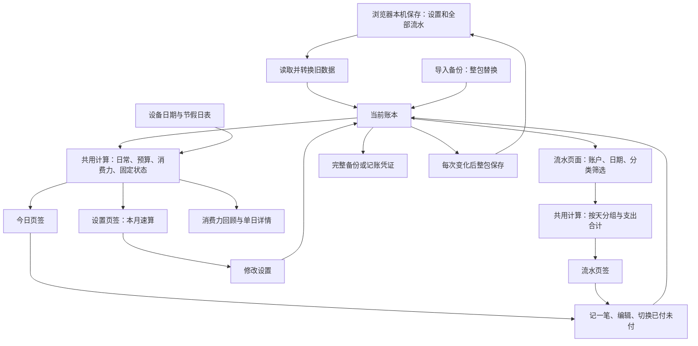

# 口袋账房：当前代码实际做了什么

> **快照审查 · Snapshot audit at commit `dc5889b`（2026-10-23）。** 本文描述的是**当时**代码的行为，是证据，不是规格，也不代表当前或预期的行为。引用前先核对适用性：`git diff dc5889b HEAD -- src/`。事实的现行来源是代码本身和根目录 `GLOSSARY.md`。

审查基线：`main`，`dc5889bff58adc0aff991549e523ad61b5b59c99`。这是产品现状说明，不是新方案，也不是按旧文档重述意图。先通读当前可执行代码，再做文档对照；注释不作为行为证据。本次只做静态阅读，没有启动页面、运行构建或修改业务代码。下文“会”指代码分支明确如此，不代表已经做过浏览器实测。

核查日期：2026-10-23；开始时工作区干净，当前提交与 main 相同。

**先纠正页面名称：当前底部三个页签实际是「今日 / 流水 / 设置」，不是「记一笔 / 消费力 / 流水」。**「记一笔」是表单弹层，「消费力回顾」从今日的「当前消费力」进入。本报告覆盖实际三个页签、回顾页及所有弹层。[实际页签](<../../src/App.tsx#L10-L14>)、[回顾入口](<../../src/app/pages/Today.tsx#L58-L64>)

## 1. Current Domain Concepts — 界面名字、代码名字、字段与限制

这是浏览器本机工具：保存设置和全部流水，没有登录用户、家庭成员、云端账本或账户余额这些对象。账户不是“银行卡里还剩多少钱”的余额台账。[本地保存](<../../src/storage/db.ts#L5-L37>)、[数据结构](<../../src/core/types.ts#L35-L67>)。下表仅为查证保留代码名字，字段同时用日常语言解释。

### 1.1 数据清单

| 界面名字 / 代码名字 | 保存了什么（普通话解释） | 实际限制与关系 |
|---|---|---|
| 整份本机数据 / PersistedState | 格式版本、设置、全部流水；当前版本3 | 整包保存在当前浏览器，没有登录或云同步。[结构](<../../src/core/types.ts#L63-L67>)、[保存](<../../src/storage/db.ts#L5-L29>) |
| 设置 / Settings | 日型、手选日型适用日期、各日型的日常列表、预算列表、固定支出列表、账户候选与两个上次使用账户、日常实际比率 | 只有当前这份设置，不保存每个历史月份的设置快照。修改后会重新计算旧日期的计划。[字段](<../../src/core/types.ts#L35-L49>)、[历史期望](<../../src/core/derive.ts#L64-L66>) |
| 日型，如工作日／周末日 / DayTypeName、dayPlans | 名字与对应的日常项目列表；另存当前选择、哪天手动选过 | 可新增名字。手动指定只对当天有效；次日按日历自动选，并不会轮流选所有自定义日型。[选择规则](<../../src/core/derive.ts#L38-L56>)、[手选](<../../src/app/pages/Settings.tsx#L343-L364>) |
| 日常、单日期望 / RoutineBucket | 名字、单日期望金额 | 每个日型各一套；新增要求名字非空、金额为正。流水不保存当时日型和期望。花超仍可记，没有付款限制。[字段](<../../src/core/types.ts#L13-L16>)、[表单](<../../src/app/pages/Settings.tsx#L62-L87>) |
| 预算、月预算 / Budget | 名字、月额度 | 周额度现场算月÷4；新增要求名字和正金额。不是余额账户，周余款不滚存。[定义](<../../src/core/types.ts#L19-L22>)、[计算](<../../src/core/derive.ts#L338-L350>) |
| 固定支出 / FixedExpense | 名字、金额、每月或每年周期 | 没填周期按月付；没有到期日、扣款日、分期或累积欠款字段。当前已付状态不在设置项上保存。[字段](<../../src/core/types.ts#L25-L33>)、[状态](<../../src/core/derive.ts#L361-L389>) |
| 账户 / accounts、lastAccount、lastTransferTo | 名字列表、上次记账账户、上次走账转入账户 | 没余额、开户额、币种、特殊资产类型。新建日常／预算／走账会记住新名字，编辑流水不会。[字段](<../../src/core/types.ts#L44-L49>)、[新建与编辑](<../../src/app/store.ts#L107-L213>) |
| 一笔流水 / MoneyRecord、records | 每笔共同有独立编号、日期时间、四种类型之一、金额；其余信息见下四行 | 新增生成编号，编辑保留。没有另外的创建／修改历史或对应设置项编号。金额按元保存，计算前不统一取整到分。[字段](<../../src/core/types.ts#L57-L61>)、[编号](<../../src/app/store.ts#L21-L23>) |
| 日常流水 / routine | 日常名字、备注、可空账户，加共同字段 | 正金额支出，没有日常收入或退款方向；可编辑成预算流水。[定义](<../../src/core/types.ts#L58-L58>)、[表单](<../../src/app/components/EntrySheet.tsx#L43-L112>) |
| 预算流水「支出／回血」 / budget | 预算名字、支出或回血方向、备注、可空账户，加共同字段 | 金额本身为正，计算时支出加、回血减。回血不关联原支出，无累计上限；没有单独「工资收入」类型。[定义](<../../src/core/types.ts#L59-L59>)、[净额](<../../src/core/derive.ts#L331-L335>) |
| 固定支出流水「标记已付／改回未付」 / fixed | 项目名字、归属月份或年份、已付或未付、可空账户，加共同字段 | 每点一次新增一条，复制当时设置金额；初次无账户，且没有备注。当前状态取同名、同周期里日期时间最后一条，不是把付款金额相加。[定义](<../../src/core/types.ts#L60-L60>)、[新增](<../../src/app/store.ts#L138-L154>)、[判断](<../../src/core/derive.ts#L367-L375>) |
| 走账 / transfer | 转出账户、转入账户、备注，加共同字段 | 新建要求两端去除首尾空白后非空、不同，金额为正；没有余额检查。不占消费额度，也不拆成两笔收支。[定义](<../../src/core/types.ts#L61-L61>)、[校验](<../../src/app/components/EntrySheet.tsx#L72-L112>) |
| 日常实际比率 / routineSpendRatio | 一个比例，未设置时60% | 滑条10%至100%，每档5%，即时保存；仅供本月速算，不影响消费力或今日期望。导入值未强制夹在这个范围。[公式](<../../src/core/derive.ts#L117-L140>)、[控件](<../../src/app/pages/Settings.tsx#L566-L598>) |
| 日期、本周、本月、本期 / ts、periodKey | 流水的日期时间；固定记录另存归属月或年 | 按设备本地日期，自然周从周一开始，可跨月；没有独立月度账本。固定状态靠归属周期，其他花费靠流水日期。[日期](<../../src/core/time.ts#L6-L42>)、[固定状态](<../../src/core/derive.ts#L367-L375>) |
| 消费力、已花、剩余、月底推算 / PaceView 等 | 不单独保存，查看时现算 | 依赖当前设置，不是按当时计划冻结的历史结果。[共用计算](<../../src/core/derive.ts#L98-L389>) |
| 备份 / VoucherFile | 格式名、版本、导出时间、全部设置、全部流水 | 导入整包替换，不追加、不合并、不去重。[格式](<../../src/storage/voucher.ts#L9-L36>) |
| 记账凭证 / FamilyLedgerVoucher | 版本、来源、导出时间、行数、跳过数；每行日期、账户、正负金额、说明、原流水编号 | 给 family ledger 的另一种导出，不是本应用完整恢复包。[字段](<../../src/storage/voucher.ts#L63-L120>) |
| 当前页、筛选、弹层 / tab、overlay 等 | 当前打开期间的界面选择 | 不属于账务事实，不随账本长期保存。[界面状态](<../../src/app/store.ts#L92-L98>)、[筛选](<../../src/app/pages/Records.tsx#L184-L211>) |

**预设账户不是特殊资产规则。**首次实际提供「现金 / 储蓄卡 / 备用金」，不是「工资卡 / 投资账户」。后两者如果在某份已有数据里出现，也只是普通名字；应用不会据此自动计算工资、投资收益或账户余额。没有证据说明某份已有数据为何取这些名字。[实际初始值](<../../src/core/seed.ts#L4-L36>)

**「待分预算」目前不是可正常操作的界面对象。**表单要求非空预算；外部数据可能带空名字，仍留在流水里，但无专门待分入口，也不会自动匹配现有预算。[表单限制](<../../src/app/components/EntrySheet.tsx#L81-L84>)、[预算计算](<../../src/core/derive.ts#L338-L350>)

### 1.2 名字就是关联方式，限制比表面上少

- 日常、预算、固定支出都靠流水名字与设置名字完全一致来认账，没有额外的固定编号。新增三个配置均不查重；因此同名不一定唯一，日常同名配置可能把同一流水重复计入汇总。[新增日常](<../../src/app/pages/Settings.tsx#L120-L138>)、[新增固定](<../../src/app/pages/Settings.tsx#L221-L241>)、[新增预算](<../../src/app/pages/Settings.tsx#L297-L315>)、[日常汇总](<../../src/core/derive.ts#L153-L162>)
- 改名会改所有同类同名历史流水。改成已有名称时再点保存确认合并，删掉原配置、沿用目标额度/周期，历史记录归到目标名字。日常只修改当前日型配置，但会改所有日型共用的同名历史记录。[日常编辑](<../../src/app/pages/Settings.tsx#L69-L117>)、[固定编辑](<../../src/app/pages/Settings.tsx#L169-L218>)、[预算编辑](<../../src/app/pages/Settings.tsx#L247-L294>)、[历史改名](<../../src/core/derive.ts#L12-L35>)
- 删除配置不删除旧流水；删除日常类别后，旧流水可能不再进今日卡片，但仍进当月消费力、回顾和流水列表。[配置删除](<../../src/app/pages/Settings.tsx#L380-L389>)、[固定删除](<../../src/app/pages/Settings.tsx#L423-L432>)、[预算删除](<../../src/app/pages/Settings.tsx#L466-L475>)、[不同统计范围](<../../src/core/derive.ts#L153-L188>)
- 通用记账金额输入提示0.00、每档0.01元，要求有效正金额；日期没有未来上限，也不必填。空日期新建时用现在，编辑时保留原日期。设置金额输入没有明确指定同样的每档金额，导入也没有同样严格的检查，不能认为所有数据都保证符合正常记账表单限制。[记账输入](<../../src/app/components/EntrySheet.tsx#L250-L277>)、[设置表单](<../../src/app/components/FormSheet.tsx#L59-L68>)、[日期转换](<../../src/core/time.ts#L46-L50>)、[编辑日期](<../../src/app/store.ts#L166-L213>)

## 2. Every Number & Formula on Screen — 每个屏幕数字怎么算

**公式放在哪里：**下表证据若指向[共用计算](<../../src/core/derive.ts>)或[日期计算](<../../src/core/time.ts>)，就是共用计算层；若只指向页面或弹层文件，就是界面自己算。导出行数及跳过数在[凭证生成](<../../src/storage/voucher.ts>)里算。第3节另列所有在界面里计算的数字。

### 2.1 所有页面共用的口径

- 今日、设置、回顾、固定支出编辑提示、连续记账提示的金额四舍五入显示整数元；流水列表每笔和每日合计保留两位小数。计算先用原数字，显示时才取整，因此屏幕上分项相加未必正好等于显示的总计。[格式函数](<../../src/app/format.ts#L1-L4>)、[流水使用](<../../src/app/pages/Records.tsx#L12-L27>)、[固定提示](<../../src/app/components/FixedExpenseSheet.tsx#L37-L39>)
- 日期按设备本地时区；周一开始，一周比较周一日期；月按自然月。不是滚动 7/30 天，也不是固定东八区。[日期边界](<../../src/core/time.ts#L6-L42>)
- 休息日先看代码内 2026 年调休工作日，再看 2026 年休假区间，否则按周六/日。没有联网拉日历；其他年份只剩周末规则。[日历表与执行顺序](<../../src/core/holidays.ts#L10-L33>)
- 自动工作日型优先叫“工作日”的配置，否则取第一个；休息日型优先“周末日”，否则取第一个非“工作日”的配置，再否则取第一个。因而“自定义日型一概不参与自动计算”并不严格成立。[真实选择函数](<../../src/core/derive.ts#L38-L47>)
- 顶部“实验版 最近更新 MM/DD HH:mm”是构建注入时间的本地格式：优先最后 Git 提交时间，取不到 Git 才用源文件最新修改时间；不是用户数据更新时间。[显示](<../../src/App.tsx#L19-L21>)、[注入](<../../vite.config.ts#L9-L26>)

### 2.2 今日页

| 可见数字/图形 | 当前算法、范围和特殊情况 | 证据 |
| --- | --- | --- |
| 日期与日型 | 本地年月日、星期；当天手选且日型仍存在就优先，否则自动推断。今日页每 60 秒重渲染一次。 | [显示与计时](<../../src/app/pages/Today.tsx#L29-L49>)、[日型](<../../src/core/derive.ts#L38-L48>) |
| 日常“今日 已花/期望” | 只枚举今日生效日型的类别：每类已花＝同名、同日的所有日常流水金额和；期望＝该日型各类 单日期望 和；已花再把这些类别结果相加。不是当天全部种类支出。 | [计算](<../../src/core/derive.ts#L153-L162>)、[显示](<../../src/app/pages/Today.tsx#L54-L70>) |
| 日常总“还能花/超” | 总期望−上述已花；负数显示“超”及绝对值。不是资金账户余额。 | [计算](<../../src/core/derive.ts#L160-L162>)、[显示](<../../src/app/pages/Today.tsx#L68-L70>) |
| 每张日常卡大金额、小金额、条形 | 大金额＝该类期望−已花，负数写“超”；右侧小数字是已花。条宽＝剩余÷期望，限制到 0%–100%；负剩余用红色，小于期望 20% 用警告色，其余常态色。 | [卡片](<../../src/app/pages/Today.tsx#L76-L99>)、[裁剪](<../../src/app/pages/Today.tsx#L9-L9>) |
| 日常“共 N 页” | 每页 4 类，页数＝类别数÷4向上取整，至少1页，只有超过一页才显示页数。 | [页数](<../../src/app/pages/Today.tsx#L43-L43>)、[提示](<../../src/app/pages/Today.tsx#L109-L110>) |
| “当前消费力 N%” | 本自然月全部日常流水金额和÷本月 1 号至今天按自动日型累加的期望全额×100，四舍五入整数%；分母≤0 时不显示入口。分母不乘 60%，不采用手选日型，会按今天的配置重算过去；分子没有排除本月未来日期记录。 | [计算](<../../src/core/derive.ts#L181-L188>)、[展示条件](<../../src/app/pages/Today.tsx#L58-L64>) |
| 预算“本周 已花/额度” | 周净支出＝本周该预算支出和−回血和；周额度＝月额度÷4。自然周可跨月。 | [计算](<../../src/core/derive.ts#L331-L350>)、[显示](<../../src/app/pages/Today.tsx#L137-L146>) |
| 预算“还能花”及条形 | 周额度−周净支出；只展示严格大于 0 的预算，按剩余从多到少排，所以花完和超支都隐藏。条宽＝剩余÷周额度，裁剪到 0%–100%；剩余小于周额度 20% 警告。回血多时剩余能大于额度，而条仍最多满格。 | [可见规则](<../../src/core/derive.ts#L354-L357>)、[显示](<../../src/app/pages/Today.tsx#L144-L153>) |
| 预算“月 已花/额度 · 按日均推算” | 月净支出＝本自然月该预算支出−回血；推算＝月净支出×本月总天数÷今天几号。推算大于月额度 105% 才标红，其余绿色；不是“剩余可花”。净支出、推算可为负。 | [月额](<../../src/core/derive.ts#L338-L350>)、[外推](<../../src/core/time.ts#L63-L65>)、[颜色](<../../src/app/pages/Today.tsx#L156-L160>) |
| 固定支出“本期 未付 ¥…/已结清” | 每项按自身月/年周期取当前状态，未付项按**配置全额**相加；年付也直接加整年金额，不除 12。不追查以前周期欠款。全付时文字“已结清”。 | [汇总](<../../src/app/pages/Today.tsx#L41-L42>)、[状态计算](<../../src/core/derive.ts#L362-L389>)、[显示](<../../src/app/pages/Today.tsx#L176-L183>) |
| “展开 N 项”、每项金额 | N＝当前固定支出配置数；金额＝当前配置金额，不是付款记录金额。年付加“·年”；已付金额划线。 | [展开和条目](<../../src/app/pages/Today.tsx#L185-L215>) |

固定支出“当前已付”精确规则：同名、同归属周期里，取日期时间最晚记录的已付／未付状态；时间相同取保存顺序较后的一条；没有记录就未付。不会再次按流水日期所属月份筛选，认的是另存的归属周期。[实现](<../../src/core/derive.ts#L367-L375>)

### 2.3 消费力回顾页及单日弹层

| 可见数字/图形 | 当前算法 | 证据 |
| --- | --- | --- |
| 月份、当前消费力百分比与进度条 | 年月为当前本地年月；百分比直接复用今日消费力公式；条宽限制 0%–100%，百分比本身不封顶。 | [计算](<../../src/app/pages/QuickRetro.tsx#L55-L66>)、[显示](<../../src/app/pages/QuickRetro.tsx#L76-L93>) |
| “本月日常实际 ÷ 已过 N 天计划” | 实际为本月全部日常流水金额之和，包括本月未来日期；N＝1 号至今天的天数（含今天）；计划＝逐日自动日型期望总和。 | [展示](<../../src/app/pages/QuickRetro.tsx#L91-L96>)、[消费力](<../../src/core/derive.ts#L181-L188>) |
| “比计划省下/超” | 已过各天计划和−已过各天全部日常支出和；负数写超。不直接使用上面的整月实际金额，所以有未来日期日常流水时两行口径不一致。 | [汇总](<../../src/core/derive.ts#L295-L311>)、[显示](<../../src/app/pages/QuickRetro.tsx#L91-L94>) |
| 日历格的日号、金额、三色 | 已过日显示当日日号、所有日常支出和取整数；未来日只显示日号不可点。实际÷自动日型计划：<80% 省，80%–100% 贴近，>100% 超；计划为 0 时，有支出算无限大/超，否则为 0/省。 | [每日数据](<../../src/core/derive.ts#L228-L259>)、[阈值](<../../src/core/derive.ts#L218-L221>)、[格子和图例](<../../src/app/pages/QuickRetro.tsx#L100-L147>) |
| “省/贴近/超”各 N 天 | 只统计已过含今天的三种状态天数，不是笔数；没有记账也会被算作支出 0 的一天。 | [汇总](<../../src/core/derive.ts#L295-L305>)、[显示](<../../src/app/pages/QuickRetro.tsx#L148-L160>) |
| “今天 D 日：实际/计划 · 省/超” | 今天所有日常实际、自动日型计划及二者差额绝对值。可能与手选日型后的今日首页不同。 | [显示](<../../src/app/pages/QuickRetro.tsx#L162-L168>)、[自动日型](<../../src/core/derive.ts#L239-L246>) |
| “近 N 天 · 实际 vs 计划”、双柱、日期 | 从本月已过日取最后最多 14 天，不跨到上月；每柱显示日号。各柱按这段时间“所有实际/计划最大值与 1 的最大者”缩放，柱高＝金额÷上述最大值×84像素，四舍五入后至少取3像素，因此 0 也有最小柱。 | [范围与缩放](<../../src/app/pages/QuickRetro.tsx#L62-L64>)、[图](<../../src/app/pages/QuickRetro.tsx#L172-L190>) |
| “工作日/周末日平均 · N 天”、两金额、百分比与条 | 只选自动日型名称**完全等于**“工作日”或“周末日”的已过日；实际均值＝组内支出和÷天数，计划均值＝计划和÷天数；比例＝组内总实际÷总计划，不是每日百分比的算术平均。条裁剪；无该类日则不显示该组。 | [组统计](<../../src/core/derive.ts#L287-L312>)、[显示](<../../src/app/pages/QuickRetro.tsx#L199-L212>) |
| “最省 D 日/最超 D 日（N% · 省/超金额）” | 在已过且计划>0 的日子中按实际÷计划排序，取最小/最大；即使全月都省，最大那天仍称“最超”，但括号内按实际差额显示“省”。只有一天时两者可为同一天。 | [排序](<../../src/core/derive.ts#L299-L309>)、[文字](<../../src/app/pages/QuickRetro.tsx#L20-L22>)、[显示](<../../src/app/pages/QuickRetro.tsx#L214-L219>) |
| 单日弹层：日期、计划、N 笔、实际、N%、省/超、条形、每笔金额 | 日期为所选月/日及星期、自动日型；N＝当日日常记录数，实际＝这些金额和；比例/颜色同日历；每笔显示类别、备注、整数金额，不显示账户和时分，不可在这里编辑。比例无限大显示“超支”。 | [弹层](<../../src/app/pages/QuickRetro.tsx#L223-L257>)、[比例文字](<../../src/app/pages/QuickRetro.tsx#L17-L22>) |

回顾所有百分比都先用原始金额求比率，再四舍五入成整数百分比；颜色用原比率，进度条表示**已花占计划的比例**并限制在0%至100%。标题消费力的计划不大于0时，计算结果为0；每日和工作日／周末日分组则是计划0且有支出显示「超支」、都0显示0%。所以这些零计划口径并不统一。[百分比显示](<../../src/app/pages/QuickRetro.tsx#L17-L22>)、[消费力](<../../src/core/derive.ts#L181-L188>)、[分组](<../../src/core/derive.ts#L287-L291>)

### 2.4 流水页、筛选及记账弹层

| 可见数字/标签 | 实际口径 | 证据 |
| --- | --- | --- |
| “全部流水 N 笔”或“筛选中 X/N 笔” | N 是全部记录条数，包含固定支出改回未付和走账；X 是同时符合账户、日期、分类的数量。分类多个选择取并集。 | [过滤](<../../src/app/pages/Records.tsx#L222-L240>)、[标题](<../../src/app/pages/Records.tsx#L276-L287>) |
| 筛选按钮“日期 M/D–M/D”“分类 N 项” | 日期显示月日，筛选比较完整本地年月日，起止均包含；N 是选中的分类条件数，不是记录数。只填开始实际没有结束限制，虽提示说“到现在”。 | [日期标签](<../../src/app/pages/Records.tsx#L212-L236>)、[日期表单](<../../src/app/pages/Records.tsx#L68-L84>)、[按钮](<../../src/app/pages/Records.tsx#L283-L287>) |
| 分类弹层“全部日常/预算/固定支出/走账 N”，各子类 N | 按当前账户和日期范围计数，**不应用当前分类筛选**；选项包含配置中的名字和所有历史流水出现过的名字，删除配置后也可筛旧记录。全部日常/预算按钮展开为各子类全选。 | [交互与显示](<../../src/app/pages/Records.tsx#L120-L170>)、[来源和计数](<../../src/app/pages/Records.tsx#L245-L265>) |
| 每日“支出 ¥N.NN” | 对**筛选后**当天记录求“全部日常 + 预算支出”；不减预算回血、不含固定支出、不含走账，不是账户净流出。日期降序，同日时间戳降序。 | [分组](<../../src/core/derive.ts#L401-L419>)、[展示](<../../src/app/pages/Records.tsx#L293-L310>) |
| 每条流水金额 | 都是记录里的金额、两位小数；预算回血加 `+`，走账灰色；固定的“改回未付”仍显示正金额，但不代表新增支出。日常/预算/固定可显示账户，走账显示两个端点。 | [标签与金额](<../../src/app/pages/Records.tsx#L12-L35>) |
| 新建/编辑弹层“金额（元）” | 预填旧记录原始金额，新建空值、提示 `0.00`；预算可选支出/回血。日常/预算账户可空；走账两端必填且不同。新建“再记一笔”保留全部字段、不关闭，提示“已记 ¥整数”；不是自动清空金额的下一笔。 | [初值与校验](<../../src/app/components/EntrySheet.tsx#L50-L84>)、[连续记账](<../../src/app/components/EntrySheet.tsx#L109-L115>)、[输入](<../../src/app/components/EntrySheet.tsx#L204-L277>) |
| 固定支出编辑“标记已付/改回未付 · ¥金额” | 显示的是那条流水保存的历史金额，取整到元；只提交日期和账户，不能在这里改金额、付/未付或备注。 | [完整表单](<../../src/app/components/FixedExpenseSheet.tsx#L24-L68>) |
| 数据管理导出提示“R 行，S 笔无账户被跳过” | 用全部流水，**不受流水页当前账户、日期、分类筛选影响**。R 是实际导出行数；先排除走账和「改回未付」固定记录，再数其余无账户记录为 S。每一条合格已付记录都导出，不按固定支出当前状态合并。没有可导出行时提示错误，不下载空凭证。 | [提示](<../../src/app/components/DataSheet.tsx#L23-L29>)、[转换](<../../src/storage/voucher.ts#L80-L128>) |

账户筛选对日常/预算/固定匹配该笔账户，走账匹配转出或转入任意一端；无账户记录在选具体账户时排除。账户选项只来自配置记忆列表，因此“编辑旧记录填了一个新账户名”不会自动让筛选列表新增它。[匹配](<../../src/app/pages/Records.tsx#L222-L230>)、[选项](<../../src/app/pages/Records.tsx#L329-L355>)、[编辑](<../../src/app/store.ts#L166-L213>)。

### 2.5 设置页、所有配置弹层和本月速算

| 可见数字/标签 | 当前算法/输入限制 | 证据 |
| --- | --- | --- |
| 日常“期望 ¥N”、编辑/新增“单日期望（元）” | 当前生效日型每项 单日期望；显示整数元，编辑预填原数字。新增例子 20 只是提示，不是默认额。 | [表单](<../../src/app/pages/Settings.tsx#L69-L138>)、[列表](<../../src/app/pages/Settings.tsx#L366-L395>) |
| 固定支出“¥N/月或年”、金额和周期表单 | 每项当前配置金额；缺周期月付。新增例子 400、每月初选；编辑原金额。 | [表单](<../../src/app/pages/Settings.tsx#L169-L241>)、[列表](<../../src/app/pages/Settings.tsx#L401-L439>) |
| 预算“月 ¥N · 周 ¥N（自动）”、月预算表单 | 月＝保存的月额度；周＝月额度÷4，都取整数显示；编辑只有月额度，没有独立周额度输入。新增例子 800 不是默认值。 | [表单](<../../src/app/pages/Settings.tsx#L247-L315>)、[列表](<../../src/app/pages/Settings.tsx#L444-L483>) |
| 本月速算日常“工作日 W 天×¥A + 休息日 R 天×¥B（全额 ¥C×实际 P%）”，金额 ¥D | W/R 按本月每一天是否休息日计数；A/B 为对应自动日型的单日期望和；C 为逐日全额和；P＝存储比率或 60%；D＝C×比率。只读设置、日历，不读流水，手选今日不改变速算。 | [逐日计算](<../../src/core/derive.ts#L98-L118>)、[显示](<../../src/app/pages/Settings.tsx#L515-L522>) |
| 本月速算预算“N 项月额度”、金额 | N＝预算配置条数；金额＝所有月额度和，不减已花、不加回血。 | [计算](<../../src/core/derive.ts#L119-L134>)、[显示](<../../src/app/pages/Settings.tsx#L524-L527>) |
| 本月速算固定月付“N 项”、金额 | N＝没填周期或选每月的设置项数；金额＝其配置全额和，不看已付状态。 | [计算](<../../src/core/derive.ts#L120-L136>)、[显示](<../../src/app/pages/Settings.tsx#L529-L532>) |
| 本月速算固定年付“N 项共 ¥A（÷12 月摊）”、金额 ¥B | N＝每年付款的设置项数；A＝年付配置金额和，B＝A÷12；只是摊算，不是本月实际付款计划。 | [计算](<../../src/core/derive.ts#L121-L139>)、[显示](<../../src/app/pages/Settings.tsx#L534-L539>) |
| “本月合计” | 日常折后预计＋全部预算月额度＋固定月付全额＋年付÷12。与今日未付金额、流水支出都不是同一个总数。 | [公式](<../../src/core/derive.ts#L140-L140>)、[显示](<../../src/app/pages/Settings.tsx#L541-L544>) |
| “调整日常实际比率”弹层，P%、“缺省60%” | 10%–100% 滑块，步长 5%；变化立刻落存储，关闭/完成不回滚；显示保存比率×100后四舍五入的整数百分比。 | [滑块](<../../src/app/pages/Settings.tsx#L566-L598>) |

首次样例会直接显示这些配置金额：工作日日常三餐 50、交通 10、咖啡 20、日用 30、其他 20（合计 130）；周末日相应 500、50、120、80、80（合计 830）；预算购物 800、学习 300、娱乐 400（周额度原值分别 200、75、100）；固定月付家政服务 2000、宠物粮 400、物业费 3000，年付会员年费 200；账户现金、储蓄卡、备用金。它们是样例配置，不是已有消费；初始流水为空。[样例](<../../src/core/seed.ts#L4-L36>)、[空流水](<../../src/storage/migrate.ts#L62-L64>)

其余共用部件没有新的金额/笔数公式：账户选择器只列名字、按输入文本包含匹配；设置通用表单只呈现上列字段；弹层点背景/Escape 关闭；删除、清空、恢复出厂使用 3 秒内再点确认；长按 450 毫秒触发、提前纵向移动超过 10 像素取消。提示通常 2 秒后消失。[账户](<../../src/app/components/AccountPicker.tsx#L17-L60>)、[表单](<../../src/app/components/FormSheet.tsx#L28-L77>)、[弹层](<../../src/app/components/Sheet.tsx#L16-L32>)、[确认](<../../src/app/components/ConfirmButton.tsx#L15-L34>)、[长按](<../../src/app/components/dragSort.ts#L3-L4>)、[长按执行](<../../src/app/components/dragSort.ts#L140-L175>)、[提示](<../../src/app/toast.ts#L10-L16>)。

## 3. Module & Data-Flow Map — 文件分工与数据流

| 主要文件 | 它负责什么 |
|---|---|
| [数据定义](<../../src/core/types.ts>) | 规定设置、四种流水与保存包有哪些字段。 |
| [初始设置](<../../src/core/seed.ts>) | 首次使用时的示例日常、预算、固定支出和账户。 |
| [本地保存](<../../src/storage/db.ts>) | 在当前浏览器读写整包账本，并申请更持久地保存。 |
| [旧数据转换](<../../src/storage/migrate.ts>) | 转换旧版本字段，基本格式不合格时使用初始账本。 |
| [备份与记账凭证](<../../src/storage/voucher.ts>) | 完整备份、恢复和供外部账本使用的另一种导出。 |
| [应用状态与操作](<../../src/app/store.ts>) | 接受新增、编辑、删除、设置变化和导入，更新账本并安排保存。 |
| [共用计算](<../../src/core/derive.ts>) | 日常、预算、消费力、固定状态、每日分组与名字关联。 |
| [日期计算](<../../src/core/time.ts>)、[节假日表](<../../src/core/holidays.ts>) | 日周月边界、休息日判断和月末推算。 |
| [启动](<../../src/main.tsx>)、[页面切换](<../../src/App.tsx>) | 读取账本、打开三个页签和回顾页。 |
| [今日](<../../src/app/pages/Today.tsx>) | 展示日常可花、预算和固定状态，提供记账入口。 |
| [消费力回顾](<../../src/app/pages/QuickRetro.tsx>) | 日历、图表、分组与单日明细。 |
| [流水](<../../src/app/pages/Records.tsx>) | 筛选、展示记录，打开新建、编辑和数据管理。 |
| [设置](<../../src/app/pages/Settings.tsx>) | 修改日型及各项计划，展示本月速算。 |
| [记一笔](<../../src/app/components/EntrySheet.tsx>)、[固定支出编辑](<../../src/app/components/FixedExpenseSheet.tsx>) | 前者填写日常、预算、走账；后者改固定记录的日期、账户或删除。 |
| [数据管理](<../../src/app/components/DataSheet.tsx>) | 发起备份、恢复、凭证导出和清空流水。 |
| [账户输入](<../../src/app/components/AccountPicker.tsx>)、[设置表单](<../../src/app/components/FormSheet.tsx>) | 名字候选、自由输入与设置填写。 |
| [弹层外壳](<../../src/app/components/Sheet.tsx>)、[确认按钮](<../../src/app/components/ConfirmButton.tsx>)、[拖动长按](<../../src/app/components/dragSort.ts>) | 弹层开关、二次确认与排序，不做账务合计。 |
| [数字显示](<../../src/app/format.ts>)、[提示](<../../src/app/toast.ts>)、[样式](<../../src/styles.css>) | 显示金额、日期、短提示和页面外观。 |

**哪些数字在界面里自己算，而非全部交给共用计算：**

- 今日：未付金额合计、每4项一页的页数、进度条宽度、颜色、预测超过105%的标记。[今日页面](<../../src/app/pages/Today.tsx#L41-L43>)、[卡片](<../../src/app/pages/Today.tsx#L85-L160>)
- 流水：组合筛选、总笔数／筛后笔数、各分类计数、选中分类数、每笔金额的正号。每日支出仍交给共用计算，但传入的是**筛选后**记录。[筛选与计数](<../../src/app/pages/Records.tsx#L221-L287>)
- 设置：列表里重复算月预算÷4、比率滑块的百分比；本月速算金额来自共用计算。[预算显示](<../../src/app/pages/Settings.tsx#L463-L463>)、[比率](<../../src/app/pages/Settings.tsx#L566-L598>)
- 回顾：近14天窗口、柱高、日均金额、显示百分比、差额文案和条宽；逐日实际、计划及分组总和来自共用计算。[图表](<../../src/app/pages/QuickRetro.tsx#L62-L64>)、[日均](<../../src/app/pages/QuickRetro.tsx#L199-L211>)
- 记账弹层显示输入金额与连续记账提示；固定编辑弹层显示历史金额；导出行数及跳过数在导出文件里计算，数据管理弹层只展示结果。[记账](<../../src/app/components/EntrySheet.tsx#L109-L115>)、[固定编辑](<../../src/app/components/FixedExpenseSheet.tsx#L37-L39>)、[导出](<../../src/storage/voucher.ts#L80-L128>)

页面先变化，再异步保存整包；保存失败只记开发者日志，用户看到「已保存」不保证本机已保存成功。首次无数据用示例设置、空流水；申请浏览器持久保存也不保证永不清除。[保存](<../../src/app/store.ts#L25-L28>)、[首次数据](<../../src/storage/migrate.ts#L51-L64>)、[持久保存](<../../src/storage/db.ts#L33-L40>)

## 4. Mismatches — 旧 ADR / 术语表与实际代码的差异

对照范围：当前根目录[术语表](<../../GLOSSARY.md>)与现存的[已标废弃 ADR](<adr/DEPRECATED-0001-unanchored-entry.md>)。先建立代码事实，再读文档；以下不是要按旧规则修程序。

| 文档说法 | 实际代码与判定 |
|---|---|
| 每日「支出」是净流出，含固定支出、回血冲减；「当日消费性支出」是旧口径。[术语表](<../../GLOSSARY.md#L42-L44>) | **直接相反。**仍是日常＋预算支出，不含固定、不减回血、不含走账；还受筛选影响。[实际公式](<../../src/core/derive.ts#L401-L418>) |
| 「待分预算」可为空，编辑能补选或清空。[术语表](<../../GLOSSARY.md#L24-L26>) | **正常界面没有实现。**没有空选项，空预算不可提交。导入能带空名字，但没有待分专区或自动承接额度。必须区别「数据可能存在」与「正常界面可操作」。[校验](<../../src/app/components/EntrySheet.tsx#L81-L84>)、[选项](<../../src/app/components/EntrySheet.tsx#L190-L202>) |
| 固定支出英文叫 commitment。[术语表](<../../GLOSSARY.md#L28-L31>) | 当前流水叫 fixed，配置叫 fixedExpenses；commitment 只作为旧数据名称被转换。[定义](<../../src/core/types.ts#L25-L61>)、[转换](<../../src/storage/migrate.ts#L27-L43>) |
| 「付/未付不落库，周期更替自动回未付」。[术语表](<../../GLOSSARY.md#L29-L29>) | 每条切换记录的已付／未付值**确实保存**；不另存的是当前周期的汇总状态。跨期只是改查新周期，有该周期记录就依它判断，不保证一定未付。[写入](<../../src/app/store.ts#L138-L154>)、[判断](<../../src/core/derive.ts#L367-L375>) |
| 「事件」是唯一事实源，所有视图数字永不保存。[术语表](<../../GLOSSARY.md#L39-L40>) | 当前集合叫 records；视图还依赖保存的设置，额度、期望等数字本来就保存。不保存的是已花、剩余、预测等汇总。流水可改、可删、可整体替换，不是不可变的历史凭证。[结构](<../../src/core/types.ts#L35-L67>)、[操作](<../../src/app/store.ts#L183-L270>) |
| 消费力分子是「本月至今」实际花费。[术语表](<../../GLOSSARY.md#L12-L15>) | **未来日期例外：**实际取整个本月流水，分母才截至今天；正常表单允许未来日期。不乘实际比率、忽略手动日型这两点与文档一致。[公式](<../../src/core/derive.ts#L181-L188>)、[日期输入](<../../src/app/components/EntrySheet.tsx#L269-L277>) |
| 预算「优先展示」还有余额的。[术语表](<../../GLOSSARY.md#L17-L20>) | 不是仅排后面：周剩余为0或负数直接隐藏。按周剩余判断，不按月剩余；月已超但周有余额仍显示。周是周一开始的自然周，可跨月。[筛选](<../../src/core/derive.ts#L338-L356>) |
| 回血「不是收入，只在本预算内部对冲」。[术语表](<../../GLOSSARY.md#L21-L21>) | 对预算额度成立；但代码不查钱的来源、不关联原支出、没有回血上限。记账凭证把回血作为账户正入账；「不是收入」是产品分类，不是程序能核验的资金性质。[净额](<../../src/core/derive.ts#L331-L335>)、[凭证](<../../src/storage/voucher.ts#L96-L103>) |
| 账户使用中自动记忆、下次默认。[术语表](<../../GLOSSARY.md#L46-L47>) | 只在新建日常／预算／走账时成立。编辑时的新账户不记忆；固定支出初次切换甚至没账户。[新建与编辑](<../../src/app/store.ts#L107-L213>) |
| 应避免把日常／预算叫「分类」。[日常用语](<../../GLOSSARY.md#L10-L10>)、[预算用语](<../../GLOSSARY.md#L22-L26>) | 屏幕仍有「按分类筛选」「日常分类（细分）」「类别名」。旧词表的语言要求并未完全落到界面；也没有用「待分预算」提供一个替代入口。[筛选](<../../src/app/pages/Records.tsx#L129-L170>)、[编辑](<../../src/app/pages/Settings.tsx#L73-L76>) |
| ADR 标为废弃，内容说流水一步进表单、自选日常／预算／走账，今日入口固定类别。[ADR](<adr/DEPRECATED-0001-unanchored-entry.md#L3-L15>) | **文档废弃不等于功能移除。**这些行为现在仍在，「再记一笔」也仍可保留内容继续记。[流水入口](<../../src/app/pages/Records.tsx#L383-L383>)、[表单切换](<../../src/app/components/EntrySheet.tsx#L161-L173>) |
| ADR 的「先记后分类」，固定支出「只从今日状态切换进入」。[ADR](<adr/DEPRECATED-0001-unanchored-entry.md#L5-L15>) | 前者实际要先选一个非空日常／预算，再日后改类，不是无归属暂存；后者只适用于新建，流水页已有固定记录编辑入口。[保存条件](<../../src/app/components/EntrySheet.tsx#L81-L103>)、[固定编辑](<../../src/app/pages/Records.tsx#L388-L389>) |

仍然相符：四种流水、日常期望不是硬上限、周预算为月÷4、走账不占消费额度、账户没有余额台账。没有把整份旧文档一概判错。

## 5. Weird Spots, Hidden Assumptions & Fragile Areas — 隐藏假设与脆弱处

### 5.1 数据安全与搬家边界

- **备份和记账凭证不是同一种文件。** 备份带本应用的格式标识、数据版本、导出时间、全设置、全流水，导入时整包替换；没有追加合并和导入前二次确认。外部记账凭证是版本1.0的逐行记录，页面没有把它导回本工具的入口。[备份结构/导入](<../../src/storage/voucher.ts#L9-L37>)、[外部结构](<../../src/storage/voucher.ts#L63-L76>)、[UI](<../../src/app/components/DataSheet.tsx#L42-L89>)
- **外部记账凭证不是净结算。** 日常/预算支出/每条已付固定记录变负数，预算回血变正数，金额四舍五入到分，日期倒序，每行带原流水编号供追溯。走账和改回未付直接跳过，因此多次“已付→未付→已付”可能导出多笔已付，不是只导出当前最后一条；缺账户另行跳过并报数。[实际导出循环](<../../src/storage/voucher.ts#L78-L121>)
- **导入不是严格验账。** 外层检查格式、数组、设置存在；迁移只检查版本是数字、设置是对象、记录是数组，不逐笔验证金额、名字、日期、周期键或未知新版本。无效外层可能回到默认设置；合法外壳不代表每个字段可安全渲染。不能宣称“所有不合法文件都会拒绝且保留原数据”。[导入](<../../src/storage/voucher.ts#L30-L36>)、[迁移与检查](<../../src/storage/migrate.ts#L8-L59>)
- “清空全部记录”保留设置；“恢复出厂”重建样例设置并清空记录。没有撤销栈。历史删除不是软删除。[数据清空](<../../src/app/store.ts#L256-L264>)、[删除](<../../src/app/store.ts#L216-L218>)

### 5.2 确认到的界面/实现错位（尚未修复）

| 现象 | 代码实际结果 | 对产品理解的影响 |
| --- | --- | --- |
| 编辑走账时可改转出/转入账户 | 表单保存只传金额、备注、普通账户、日期；保存时保留原来的转出／转入账户，新选的两端不会保存。 | 不能说“走账各字段都能改”；目前只有金额、备注、日期的编辑真正落下。[输入](<../../src/app/components/EntrySheet.tsx#L214-L235>)、[提交](<../../src/app/components/EntrySheet.tsx#L101-L103>)、[保存](<../../src/app/store.ts#L166-L178>) |
| 固定支出编辑提示“金额在设置里改” | 设置修改配置金额；旧流水金额不变，日期/账户编辑也保留该金额。 | 今日固定项显示新配置金额，旧流水/凭证仍是旧金额；不是历史付款金额跟随设置更新。[提示](<../../src/app/components/FixedExpenseSheet.tsx#L37-L39>)、[配置修改](<../../src/app/pages/Settings.tsx#L186-L190>)、[旧流水编辑](<../../src/app/store.ts#L197-L211>) |
| 新增日型提示“已建并切换” | 只保存新日型名字，没保存「今天手动选过」的日期；当天没有有效手选标记时，自动日型仍可能覆盖新值。 | 新建不保证马上切到它；需要区分“新增类型”和“今天选用”。[新增](<../../src/app/pages/Settings.tsx#L142-L158>)、[生效规则](<../../src/core/derive.ts#L45-L47>) |
| 日常页面展示按今天生效日型，但新增／删除按之前保存的日型名字 | 编辑／拖动用今天生效的日型；新增／删除却用之前保存的选择。自动日型与保存值不同（如跨天或前述新增）时，操作目标可能不是当前看到的列表。 | 不能把“看见哪个日型就一定改哪个”写成保证。[显示取值](<../../src/app/pages/Settings.tsx#L40-L49>)、[新增](<../../src/app/pages/Settings.tsx#L133-L135>)、[删除](<../../src/app/pages/Settings.tsx#L383-L386>) |
| 消费力称“月至今”，输入却能选未来 | 分子取全月，回顾的省/超和状态天数只取已过日；预算周/月统计也没有排除未来记录。 | 未来记录会提前改变今日消费力/预算，但回顾未来格不展示金额。[日期输入](<../../src/app/components/EntrySheet.tsx#L269-L277>)、[消费力](<../../src/core/derive.ts#L181-L188>)、[回顾](<../../src/core/derive.ts#L295-L307>)、[预算](<../../src/core/derive.ts#L338-L349>) |
| 日期筛选说“只填开始＝从那天到现在” | 实际只过滤小于开始日期者，没有加截至今天条件。 | 未来日期记录也能匹配。[文案](<../../src/app/pages/Records.tsx#L82-L84>)、[代码](<../../src/app/pages/Records.tsx#L232-L236>) |
| 预算设置说“改月预算/周额度” | 表单只改月预算；周额度始终月÷4。 | 周额度不能单独调。[文案](<../../src/app/pages/Settings.tsx#L446-L447>)、[字段](<../../src/app/pages/Settings.tsx#L251-L255>) |
| 速算说明说“自定义日型不计入” | 自动日型找不到标准名字时会取自定义名字作后备。 | 删除/导入特殊配置时，自定义也可能影响速算；回顾的工作/周末分组反而只认两个标准名字。[说明](<../../src/app/pages/Settings.tsx#L550-L551>)、[后备规则](<../../src/core/derive.ts#L38-L41>)、[分组](<../../src/core/derive.ts#L310-L311>) |

### 5.3 对账、缺失数据和数字边界

1. **「花了多少」至少有三套答案。**今日只看当前日型现存日常名字；消费力／回顾看全部日常；流水每日支出再加预算支出，却不扣回血、不加固定。举例：同一天日常100元、预算支出200元、回血50元、固定已付1000元、走账500元，每日「支出」为**300元**，不是净流出1250元；该预算净支出则是150元。[今日日常](<../../src/core/derive.ts#L153-L162>)、[消费力](<../../src/core/derive.ts#L181-L188>)、[每日支出](<../../src/core/derive.ts#L401-L418>)

2. **预算没有另存的“已花账”，隐藏不等于归零。**每次按同名流水重新算净额；周余额为0或负数整行消失，流水仍在。删除预算不删历史；重建同名预算会认回旧流水。空名字／已删名字的预算支出仍进每日支出，但没有当前预算额度承接。[预算公式与隐藏](<../../src/core/derive.ts#L331-L356>)、[历史筛选名字](<../../src/app/pages/Records.tsx#L245-L254>)

3. **名字是关联纽带，新增不查重，重名可重复统计。**日常同名项会各算一次相同流水；预算同名项也各算同一净支出。改名只改当前日型配置，却改所有同名历史日常；其他日型的旧名字可能还在。合并不是把额度相加，而是采用目标额度。改设置和改历史又是两次保存，不是一齐成功或失败。[新增与改名](<../../src/app/pages/Settings.tsx#L69-L158>)、[历史改名](<../../src/core/derive.ts#L12-L35>)、[保存](<../../src/app/store.ts#L247-L253>)

4. **无账户不会丢掉金额，无分类却可能脱离计划。**无账户记录照常参加花费计算，具体账户筛选会排除它；没有「无账户」专门筛选。分类候选会补进历史已删名字，账户候选却只看记忆名单，因此编辑时新填的账户可能无法直接选来筛。已删日常不进今日卡片，却仍进消费力／回顾。[筛选](<../../src/app/pages/Records.tsx#L222-L265>)、[账户选项](<../../src/app/pages/Records.tsx#L329-L355>)、[日常口径](<../../src/core/derive.ts#L153-L188>)

5. **显示精度、颜色边界不统一。**今日条画剩余，回顾条画已花；刚好花80%时今日仍绿，回顾已橙；预算月底预测超过105%才红。显示取整但判色用原值，所以79.6%可显示80%仍绿，100.1%显示100%却红，超支几分钱也可写「超 ¥0」。[金额显示](<../../src/app/format.ts#L1-L4>)、[今日颜色](<../../src/app/pages/Today.tsx#L90-L96>)、[预测](<../../src/app/pages/Today.tsx#L158-L158>)、[回顾阈值](<../../src/core/derive.ts#L218-L221>)

6. **零计划不是统一隐藏。**删除全部日常后，今日即使有历史花费也显示0／0、剩余0，消费力入口隐藏；回顾计划0且花费0的日子计入「省」，计划0却有花费计「超」，但后者不参加「最超」排名，因为排名只收计划大于0的日子。只有一天时最省和最超还可以是同一天。[今日](<../../src/core/derive.ts#L153-L162>)、[入口](<../../src/app/pages/Today.tsx#L58-L64>)、[回顾](<../../src/core/derive.ts#L243-L254>)、[排名](<../../src/core/derive.ts#L295-L309>)

7. **固定状态、历史金额、导出付款是三件事。**已付后改回未付，不会抵消之前可导出的已付记录；初次切换无账户又会被导出跳过。改金额或周期不批量更新历史；编辑固定流水日期／账户时才按当前设置周期重新归期，项目已删则默认按月。[新建](<../../src/app/store.ts#L138-L154>)、[编辑归期](<../../src/app/store.ts#L197-L213>)、[导出](<../../src/storage/voucher.ts#L83-L106>)

8. **本月速算与预算预测回答不同问题。**速算完全不读流水，使用全月日历、所有配额、日常比例，含已隐藏的预算，也不扣已付固定。预算预测则用净支出按今天日序放大。年付÷12是摊算，不是本月待付款；今日未付却直接加年付全额。[速算](<../../src/core/derive.ts#L98-L141>)、[预算外推](<../../src/core/time.ts#L63-L65>)、[未付](<../../src/app/pages/Today.tsx#L41-L42>)

9. **时间和语言也有写死值。**日历只内置2026年调休与假期，其他年份只按周末；自动选择偏向「工作日／周末日」，回顾分组只认这两个名字。设备时区影响日期归属。安装说明还写「节律 · 预算池 · 义务 · 走账」，与当前屏幕用语不同。[日历](<../../src/core/holidays.ts#L10-L33>)、[日型](<../../src/core/derive.ts#L38-L47>)、[分组](<../../src/core/derive.ts#L310-L311>)、[安装说明](<../../vite.config.ts#L33-L36>)

覆盖声明：已阅读当前页面、弹层、数据定义、计算、保存和导入导出，并在此后逐条对照现存术语表与 ADR。只新增本报告，未改应用代码、测试或界面，未运行构建或会产生缓存的测试；静态发现不冒称浏览器实测。
